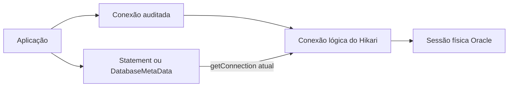
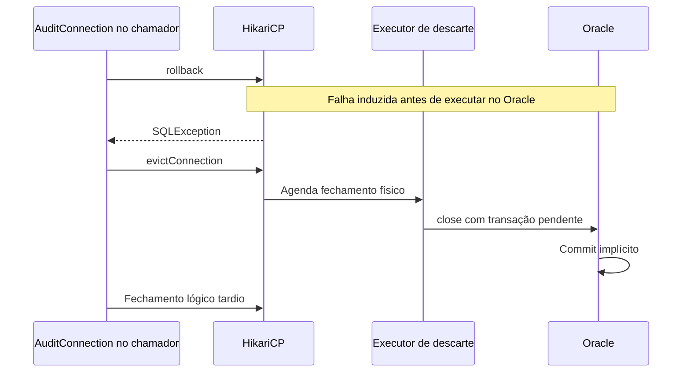

# Os cinco casos de falha da auditoria Oracle e suas soluções

A dupla limpeza acrescentada à POC funciona nos cenários de entrada: a conexão é limpa antes de receber a identidade atual e volta a ser limpa no fechamento normal. Mesmo assim, cinco testes continuam reprovados. Eles apontam para três causas: caminhos de fechamento que contornam a auditoria, perda da exceção original durante o descarte e confirmação de uma transação que deveria ter sido desfeita.

As correções descritas a seguir são propostas para esses defeitos. A implementação atual contém somente a dupla limpeza; as demais correções ainda precisam ser implementadas e comprovadas pelos testes.

| Caso | O que falhou | Efeito comprovado |
| --- | --- | --- |
| 1 | Fechar a conexão obtida de um `Statement` | A sessão volta ao pool com os atributos de Ana. |
| 2 | Fechar a conexão obtida de `DatabaseMetaData` | Outra rota devolve a sessão ao pool com os atributos de Ana. |
| 3 | O rollback falha durante o fechamento | Um `NullPointerException` oculta a `SQLException` original. |
| 4 | A restauração do autocommit falha | O mesmo tipo de erro secundário oculta a falha de restauração. |
| 5 | O fechamento físico ocorre após uma falha de rollback | Dados, marcador transacional e eventos de auditoria são confirmados, embora o resultado esperado fosse rollback. |

**Os cinco casos não significam cinco ocorrências de autoria trocada.** Os casos 1 e 2 comprovam sessões sujas na devolução; os casos 3 e 4 comprovam perda do diagnóstico original; o caso 5 comprova um problema de finalização da transação. Nos fluxos aprovados não foi observada divergência de autoria.

## Como a conexão e a auditoria se relacionam

O usuário da aplicação e o usuário do banco são identidades diferentes. Ana e Bruno podem acessar o sistema com contas distintas, enquanto a aplicação usa uma única conta técnica para abrir conexões Oracle. Para que a trigger identifique o autor real, a aplicação preenche atributos da sessão:

| Atributo Oracle | Informação da aplicação | Exemplo usado nos testes |
| --- | --- | --- |
| `CLIENT_IDENTIFIER` | Usuário autenticado | `sub-ana` |
| `CLIENT_INFO` | IP do usuário | `2001:db8::1` |
| `MODULE` | Aplicativo | `internal` |

Esses atributos pertencem à sessão física. Eles podem continuar presentes depois de commit ou rollback; por isso, o ciclo da conexão precisa cuidar de sua configuração e limpeza.

Uma **conexão física** é a sessão mantida com o Oracle. O HikariCP guarda essas conexões para reutilizá-las. A aplicação recebe uma **conexão lógica**, que representa um empréstimo dessa sessão. Fechar a conexão lógica normalmente significa devolvê-la ao pool; encerrar a conexão física significa terminar a sessão com o banco.

Na POC existe ainda o `AuditConnection`, um **wrapper**: um objeto que envolve a conexão lógica para configurar a identidade e executar a limpeza no fechamento. A aplicação precisa passar por esse objeto para que seu controle seja aplicado.

O fluxo normal atual é:

```text
Retirada do pool
  Resolver e validar a identidade
  → obter a conexão lógica
  → limpar os atributos da sessão
  → configurar usuário, IP e aplicativo atuais
  → entregar a conexão auditada à aplicação

Devolução normal
  Desfazer trabalho pendente, se necessário
  → restaurar autocommit
  → limpar os atributos da sessão
  → fechar a conexão lógica e devolvê-la ao pool
```

**Evicção** é a retirada de uma conexão do pool para descarte, em vez de sua reutilização. Ela não equivale a rollback: solicitar descarte não comprova que a transação pendente foi desfeita.

## Caso 1 Fechamento pela conexão obtida de um Statement

### Como acontece

Um `Statement` é o objeto JDBC usado para executar comandos SQL. Ele possui o método `getConnection()`, que permite obter a conexão à qual está associado. Atualmente, a referência retornada por esse método é a conexão lógica do Hikari, sem o wrapper de auditoria da POC.

O caminho que reproduz o problema pode ser representado assim:

```java
Connection auditada = dataSource.getConnection(); // Identidade de Ana.
Connection outraReferencia;

try (Statement statement = auditada.createStatement()) {
    outraReferencia = statement.getConnection();
}

outraReferencia.close(); // Contorna AuditConnection.close().
```

Esse trecho ilustra a rota defeituosa, não um padrão recomendado para a aplicação. Fechar o `Statement` e fechar a conexão retornada por ele são ações diferentes.



Quando a aplicação fecha `outraReferencia`, o Hikari recebe a conexão de volta. Como a chamada não passou por `AuditConnection.close()`, a limpeza de saída não executa. O teste examina a sessão ociosa e encontra `sub-ana`, `2001:db8::1` e `internal` ainda preenchidos.

### Por que a dupla limpeza não resolve esse caso

A limpeza de entrada só será executada no próximo checkout normal. O teste verifica o instante anterior a esse checkout: a sessão já foi devolvida e ainda está suja. Quando Bruno obtém uma conexão pelo caminho auditado, a nova limpeza e a configuração de sua identidade acrescentam proteção, mas não corrigem a devolução anterior.

O resultado comprova uma rota que contorna a limpeza. Ele não comprova, sozinho, que o checkout normal seguinte tenha gravado um evento no nome de Ana.

### Solução proposta

Envolver os objetos `Statement`, `PreparedStatement` e `CallableStatement` retornados pela conexão auditada. Seu `getConnection()` deve devolver a mesma conexão auditada que os criou. Assim, fechar a conexão por essa referência passa pelo controle de auditoria e pelo mesmo fechamento idempotente.

Também é necessário proteger os caminhos indiretos por `ResultSet.getStatement()`, para que não ofereçam outra referência ao statement sem proteção. Fechar somente um statement deve continuar fechando somente aquele recurso: não deve limpar antecipadamente a identidade da conexão, que ainda pode executar outros comandos ou um flush do Hibernate.

**Como comprovar:** fechar a conexão por `Statement.getConnection()`, observar os atributos vazios antes de outro checkout e depois comprovar a autoria de Bruno na reutilização normal. Operações de banco por recursos antigos devem falhar depois do encerramento do empréstimo.

## Caso 2 Fechamento pela conexão obtida dos metadados

### Como acontece

`DatabaseMetaData` fornece informações sobre o banco, tabelas e recursos JDBC. Esse objeto também possui `getConnection()`. A falha é semelhante à anterior, mas usa outra interface pública:

```java
Connection auditada = dataSource.getConnection();
DatabaseMetaData metadados = auditada.getMetaData();
Connection outraReferencia = metadados.getConnection();
outraReferencia.close(); // Também contorna a limpeza da POC.
```

O fechamento devolve a conexão lógica ao Hikari sem executar a limpeza de saída. O segundo teste encontra os mesmos três atributos de Ana na sessão ociosa.

### Solução proposta

Envolver `DatabaseMetaData` e fazer seu `getConnection()` retornar a conexão auditada original. Se seus métodos retornarem resultsets que permitam chegar a outros objetos JDBC, esses caminhos também precisam preservar a proteção.

Os casos 1 e 2 devem compartilhar o estado do mesmo empréstimo. Fechar por metadados, por statement ou pela variável original precisa encerrar a conexão uma única vez. Corrigir apenas o statement deixaria a rota dos metadados aberta.

**Como comprovar:** repetir a inspeção da sessão antes do próximo checkout, agora fechando pela referência dos metadados. O próximo usuário deve receber uma sessão limpa e ter seus eventos reconciliados com a identidade esperada.

## Caso 3 Uma falha de rollback é ocultada por outro erro

### Como acontece

Com `autoCommit=false`, uma transação pode conter trabalho ainda não confirmado. No fechamento normal, o wrapper tenta executar rollback antes de limpar a identidade. Nesse teste, uma `SQLException` é induzida no rollback.

A sequência do caminho atual é:

1. `AuditConnection.close()` tenta executar rollback.
2. O rollback lança a exceção original, como `SQLException: Injected ROLLBACK`.
3. O tratamento chama `discardAndClose()`, que solicita a evicção ao Hikari.
4. Depois da evicção, o tratamento chama `close()` novamente na referência lógica antiga.
5. Esse fechamento entra na restauração de estado do Hikari e encontra uma referência de conexão já retirada, produzindo `NullPointerException`.

O teste esperava receber a `SQLException` do rollback. Recebeu o erro secundário em `PoolBase.resetConnectionState`. O fluxo de retirada da conexão e o reset de estado podem ser consultados em [PoolEntry](https://github.com/brettwooldridge/HikariCP/blob/HikariCP-6.3.3/src/main/java/com/zaxxer/hikari/pool/PoolEntry.java) e [PoolBase](https://github.com/brettwooldridge/HikariCP/blob/HikariCP-6.3.3/src/main/java/com/zaxxer/hikari/pool/PoolBase.java), na versão analisada do Hikari.

O impacto comprovado aqui é a perda do diagnóstico: quem recebe a falha passa a investigar um acesso nulo, enquanto o erro que iniciou o problema foi o rollback. Os testes de isolamento verificam separadamente o descarte e a substituição da sessão; esta falha não demonstra troca de autoria.

### Solução proposta

Reestruturar o descarte para não executar novamente o fechamento lógico do proxy Hikari depois de solicitar sua evicção. A liberação física deve ter um responsável definido, com o tratamento seguro explicado no caso 5.

A primeira exceção deve continuar sendo a principal. Erros adicionais de descarte ou liberação, sejam SQL ou de runtime, devem ser anexados como exceções suprimidas, por `addSuppressed()`, em vez de substituí-la. Por exemplo:

```text
SQLException: falha no rollback
  Suppressed: SQLException: falha adicional ao interromper a conexão
```

Preservar a exceção melhora o diagnóstico, mas não comprova a segurança da transação: o descarte também precisa impedir o commit indevido do caso 5.

**Como comprovar:** induzir a falha no rollback, exigir a exceção original no chamador, inspecionar eventuais erros suprimidos e verificar que outro usuário não recebe a sessão descartada.

## Caso 4 Uma falha na restauração do autocommit é ocultada

### Como acontece

Autocommit é a configuração que determina se os comandos são confirmados automaticamente. Na sequência normal da POC, primeiro acontece o rollback do trabalho pendente e, somente depois, a restauração por `setAutoCommit(true)`.

Neste teste, o rollback retorna com sucesso. A falha é induzida na etapa seguinte, `AUTOCOMMIT_RESET`:

```text
rollback retorna com sucesso
→ setAutoCommit(true) falha
→ tratamento solicita evicção
→ tratamento fecha novamente o proxy lógico antigo
→ reset de estado lança NullPointerException
```

O erro secundário oculta a falha de restauração do autocommit. Embora compartilhe a causa de descarte do caso 3, esse teste protege uma etapa diferente do fechamento. Corrigir somente a captura de erros do rollback não seria suficiente.

### Solução proposta

Usar o mesmo mecanismo de descarte seguro e preservação da primeira exceção do caso 3, incluindo falhas na restauração de estado. Uma conexão cujo reset falhou deve sair de circulação; não deve ser devolvida como se estivesse pronta para o próximo empréstimo.

A ordem rollback antes de autocommit precisa ser preservada. Alterar o modo de autocommit durante uma transação pode confirmá-la, conforme o [contrato JDBC de setAutoCommit](https://docs.oracle.com/en/java/javase/21/docs/api/java.sql/java/sql/Connection.html#setAutoCommit(boolean)). A limpeza dos atributos de auditoria não substitui a finalização transacional.

**Como comprovar:** induzir o erro de reset depois do rollback bem-sucedido, exigir a `SQLException` original, impedir que um erro secundário a substitua e comprovar a substituição da sessão física.

## Caso 5 Uma transação que deveria ser desfeita termina confirmada

### Como acontece

Este é o caso mais crítico porque o teste encontrou dados persistidos quando esperava ausência de confirmação. A concorrência relevante ocorre entre a thread que trata o fechamento lógico e a tarefa que encerra a conexão física, não entre dois usuários executando SQL simultaneamente na mesma conexão.

O teste executa esta sequência:

1. Abre uma conexão auditada e desabilita autocommit.
2. Insere um registro de negócio e um marcador na mesma transação. A trigger também produz um evento de auditoria nessa transação.
3. Fecha a conexão esperando rollback do trabalho pendente.
4. Induz uma falha antes de o rollback chegar ao Oracle.
5. Solicita evicção e controla o escalonamento para que o fechamento físico termine antes de o chamador continuar com o fechamento lógico.
6. Consulta o banco por uma conexão independente e encontra a transação confirmada, incluindo os registros de negócio e auditoria.



O Oracle documenta commit implícito quando uma conexão é fechada com trabalho pendente e autocommit desabilitado. Esse comportamento explica o resultado observado no fechamento físico. [Oracle JDBC sobre confirmação de alterações](https://docs.oracle.com/en/database/oracle/oracle-database/19/jjdbc/JDBC-getting-started.html).

No teste, o callback apenas aguarda o fechamento assíncrono. Ele não chama commit nem introduz DML concorrente na mesma conexão. A barreira demonstra uma ordem de execução possível que causa o defeito; não mede a frequência dessa ordem em produção.

O evento de auditoria confirmado não foi observado com o nome de outro usuário nesse caso. O problema é confirmar uma operação que deveria ter sido desfeita. Como a auditoria participa da transação de negócio, ambos acabam persistidos.

### Solução proposta

Adicionar uma proteção no fechamento da conexão física, entre o Hikari e o driver Oracle. Essa proteção deve permitir fechamento normal somente quando não houver trabalho pendente ou quando o rollback tiver retornado com sucesso. Se não for possível assegurar isso, deve interromper a sessão por `abort`, sem permitir que o fechamento normal confirme a transação pendente.

Essa camada precisa atuar também nos descartes automáticos. O Hikari possui tratamento próprio de exceções que pode disparar evicção, e agenda o fechamento físico em um executor. Assim, tratar somente o erro que chega ao wrapper externo pode ser tarde. Essa relação aparece em [ProxyConnection](https://github.com/brettwooldridge/HikariCP/blob/HikariCP-6.3.3/src/main/java/com/zaxxer/hikari/pool/ProxyConnection.java) e [HikariPool](https://github.com/brettwooldridge/HikariCP/blob/HikariCP-6.3.3/src/main/java/com/zaxxer/hikari/pool/HikariPool.java).

As responsabilidades propostas ficam assim:

| Camada | Responsabilidade |
| --- | --- |
| Conexão auditada e objetos JDBC derivados | Manter identidade e dupla limpeza, controlar o empréstimo e evitar as rotas de fechamento dos casos 1 e 2. |
| HikariCP | Administrar os empréstimos, a capacidade e a retirada das conexões do pool. |
| Proteção da conexão física | Garantir rollback antes do fechamento normal ou interromper a sessão quando sua finalização não puder ser assegurada. |

`abort` encerra o uso da conexão e pode continuar liberando recursos em segundo plano. Se também falhar, a conexão deve permanecer indisponível para empréstimos, com a falha sinalizada; um fechamento normal com transação pendente não deve ser usado como recuperação. [Contrato JDBC de abort](https://docs.oracle.com/en/java/javase/21/docs/api/java.sql/java/sql/Connection.html#abort(java.util.concurrent.Executor)).

Essa solução precisa ser validada com o driver utilizado. Ela também não desfaz um commit que já tenha ocorrido: erros de comunicação durante um commit podem deixar seu resultado incerto e exigem reconciliação, como nos testes de marcador transacional existentes.

**Como comprovar:** manter o teste que força a corrida, exigir ausência do registro, do marcador e do evento de auditoria para o rollback esperado e comprovar que a sessão descartada não é reutilizada. Acrescentar variações com evicção automática, falhas de abort e limites de espera para as tarefas de descarte.

## O papel da dupla limpeza depois dessas correções

A limpeza de entrada continua útil para remover atributos antigos antes de configurar o próximo autor. A limpeza de saída continua necessária para que a sessão permaneça limpa enquanto está ociosa. Nenhuma delas, isoladamente, controla todas as referências JDBC ou comprova o resultado de uma transação.

| Barreira | Objetivo |
| --- | --- |
| Limpeza antes da configuração | Remover atributos anteriores antes de entregar a conexão ao autor atual. |
| Configuração completa da identidade | Garantir usuário, IP e aplicativo corretos antes do trabalho de negócio. |
| Limpeza na devolução por todas as rotas protegidas | Impedir sessões sujas no pool ocioso. |
| Descarte físico seguro | Impedir reutilização de sessões inválidas e confirmação indevida de trabalho pendente. |
| Preservação da exceção | Permitir identificar a falha original e os problemas secundários. |

Há ainda um limite adicional: `unwrap(OracleConnection.class)` pode expor acesso direto ao driver. O teste desse acesso é um diagnóstico separado, fora dos cinco casos reprovados. Uma política mais restrita de unwrap ou proxies para interfaces do fabricante precisa considerar compatibilidade antes de ser adotada; uma referência física livre pode contornar controles do empréstimo lógico.

## Como acompanhar a correção dos cinco casos

Os testes de regressão atuais devem manter suas expectativas. O critério é corrigir o comportamento, sem aceitar atributos antigos, substituir a exceção esperada por qualquer erro ou tratar um commit inesperado como sucesso.

| Casos | Teste de referência | Condição para aprovação |
| --- | --- | --- |
| 1 e 2 | `OracleConcurrencyTest.jdbcConnectionAliasesMustNotReturnDirtySessionsToThePool`, parâmetros `statement` e `metadata` | A sessão está limpa antes do próximo checkout e o fechamento passa pelo controle de auditoria. |
| 3 e 4 | `OracleLifecycleFaultTest.lifecycleFailuresMustNotBeReplacedByAnUnrelatedNullPointer`, parâmetros `ROLLBACK` e `AUTOCOMMIT_RESET` | A exceção original chega ao chamador e a conexão inválida não volta a ser emprestada. |
| 5 | `OracleLifecycleFaultTest.failedRollbackMustNotCommitWhenPhysicalEvictionWinsTheCleanupRace` | A transação destinada a rollback não aparece confirmada, mesmo com fechamento físico antecipado. |

A prioridade técnica é resolver o descarte e o fechamento físico do caso 5 junto com a preservação de exceções dos casos 3 e 4, depois fechar as rotas dos casos 1 e 2. A validação deve incluir os testes atuais, os novos cenários de evicção automática, as mutações e os estresses no Free 23 e no Oracle 19c.

Na execução com dupla limpeza de 8 de novembro de 2026, o Free 23 teve 107 cenários: 102 aprovados e os cinco casos acima reprovados. Os dois estresses passaram e as dez mutações foram detectadas. O ambiente utilizou Oracle `23.26.3.0.0`, driver `23.9.0.25.07`, HikariCP `6.3.3` e Java `21.0.9`. A execução no 19c permanece pendente por falta de ambiente configurado.

Os resultados completos e os identificadores dos relatórios estão no [status da implementação](implementation-status.md). O [registro dos achados](audit-concurrency-findings.md) resume as falhas, e o [guia da bateria](audit-concurrency.md) explica como executar a validação.
